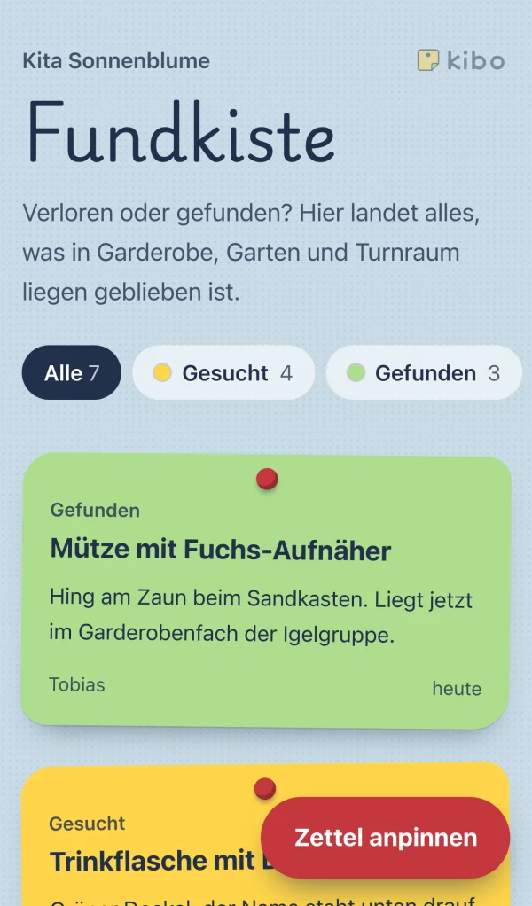
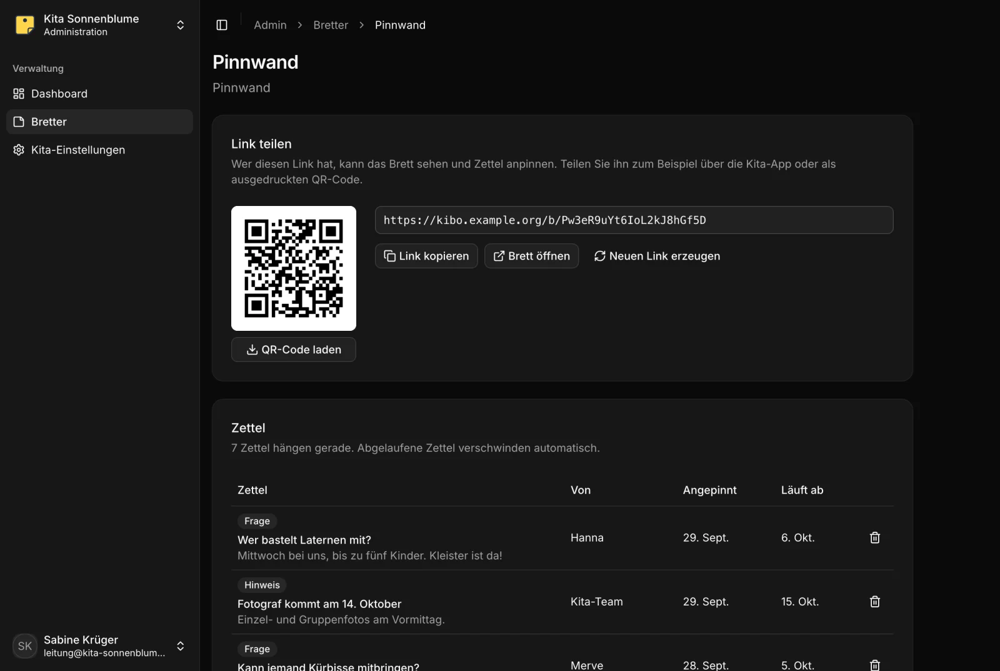

# Kibo – die digitale Pinnwand für Kita-Eltern

Kibo (**Ki**ta-**Bo**ard) ist eine digitale Pinnwand, auf der sich die Eltern einer Kita selbst austauschen: gefunden, gesucht, zu verschenken. Die Kita-Leitung legt Bretter an und teilt sie über einen nicht erratbaren Link oder QR-Code; wer den Link hat, pinnt dort Zettel an – im Browser, ohne Konto und ohne Messenger-Gruppe.

Aktuelle Version: **1.2.2** – Änderungen stehen im [CHANGELOG](CHANGELOG.md).


## So sieht es aus

<table>
  <tr>
    <td width="70%"></td>
    <td width="30%"></td>
  </tr>
  <tr>
    <td>Eltern pinnen Zettel ohne Konto an und wählen, wie lange sie hängen.</td>
    <td>Auf dem Handy, ohne App.</td>
  </tr>
</table>



Im Admin-Bereich legt die Kita Bretter an, teilt sie per Link oder QR-Code und behält alle Zettel im Blick.

Zum Weitergeben an Kita-Leitung oder Träger: das zweiseitige **[Infoblatt (PDF)](docs/kibo-infoblatt.pdf)** mit Funktionen, Betrieb und Betreibermodell.

Wie Kibo benutzt und betrieben wird, steht in der **[Dokumentation](docs/README.md)**: ein Teil für Kitas, einer für alle, die eine eigene Instanz hosten.

## Funktionen

- **Kitas:** Jede Kita ist eine eigene Organisation. Wer sich registriert, legt dabei seine Kita an und ist ihre Inhaberin oder ihr Inhaber. Inhaber laden weitere Admins per E-Mail ein: Alle verwalten Bretter und Zettel gemeinsam; einladen, Mitglieder entfernen und die Kita umbenennen kann nur, wem sie gehört. Admins können eine Kita wieder verlassen.
- **Anmeldung:** E-Mail und Passwort, optional mit Zwei-Faktor-Authentifizierung per Authenticator-App (TOTP) inklusive Backup-Codes zum Kopieren oder Herunterladen, oder mit Passkey. Ein Konto kann bis zu drei Kitas anlegen; Mitgliedschaften per Einladung zählen nicht mit. Pro Instanz lässt sich die Registrierung schließen oder auf bestimmte E-Mail-Domains beschränken; Konten legt dann der Betrieb per Skript an, und wer zu einer Kita eingeladen ist, registriert sich über den Link aus der Einladungsmail.
- **Admin-Bereich:** unter `/admin`, mit Kita-Wechsler, Dashboard, Brettern, Kita-Einstellungen und Kontoeinstellungen.
- **Bretter:** Jede Kita legt beliebig viele Bretter an. Die Art des Bretts bestimmt die Kategorien: Fundkiste (Gesucht/Gefunden), Biete & Suche oder Pinnwand (Hinweis/Frage/Termin).
- **Teilen:** Jede Kita hat einen nicht erratbaren Kita-Link `/k/…/`, der alle ihre Bretter zeigt, im Admin-Bereich auch als QR-Code zum Ausdrucken – für die ganze Kita oder direkt zu einem Brett. Ein neuer Kita-Link macht alle alten Links ungültig.
- **Zettel:** Besucher pinnen ohne Konto Zettel an, die nach 7, 14 oder 30 Tagen automatisch verschwinden. Eigene Zettel lassen sich vom selben Gerät aus vorzeitig abnehmen. Die Kita kann jeden Zettel entfernen.
- **Meldungen:** Wer einen Zettel für unpassend hält, meldet ihn ohne Konto; die Kita bekommt eine E-Mail und bearbeitet die Meldung im Admin-Bereich. Rechtswidrige Inhalte lassen sich zusätzlich an den Betreiber der Instanz melden (Digital Services Act).
- **Datenexport:** Jede Kita lädt ihre Bretter und aktuellen Zettel jederzeit als JSON-Datei herunter; das Format ist in [`docs/selbst-hosten/datenexport.md`](docs/selbst-hosten/datenexport.md) beschrieben.
- **Benachrichtigungen:** Eltern schalten per Glocke Benachrichtigungen für ein Brett ein und erfahren auf dem Handy, sobald dort ein neuer Zettel hängt – über Web Push, ohne App und ohne Drittanbieter-Konto. Die Kita-Seite kommt einmal auf den Home-Bildschirm, die Glocke gibt es pro Brett; auf dem iPhone ab iOS 18.4. Neue Zettel werden gesammelt und gedrosselt; die Kita kann die Funktion pro Brett abschalten. Optional, siehe [Benachrichtigungen (Web-Push)](docs/selbst-hosten/benachrichtigungen.md).
- **Spam-Schutz:** Honeypot-Feld, mehrstufige Budgets je Netz und je Link, Erkennung wiederholter Inhalte, begrenzte Anmeldeversuche, Auth-Mails und Einladungen. Gezählt wird in PostgreSQL, also über Neustarts und Prozesse hinweg. Die eigenen Budgets speichern statt IP-Adressen, Links, E-Mail-Adressen oder Zetteltexten nur HMAC-Prüfwerte, die nach spätestens gut einem Tag verfallen. IP-Adressen im Klartext speichert nur Better Auth: in den Zählern seiner Anmeldebegrenzung (etwa eine Stunde) und zu jeder Sitzung eines Kita-Kontos (samt Browserkennung, solange die Sitzung läuft). Regeln und Grenzwerte: [`docs/selbst-hosten/spam-schutz.md`](docs/selbst-hosten/spam-schutz.md).
- **Sicherheits-Header:** Content-Security-Policy, Schutz vor Einbettung, keine Referrer von Brettern und `no-store` für den Admin-Bereich setzt die Anwendung selbst; HSTS kommt vom Reverse Proxy.
- **Dokumentation:** Anleitungen für Kitas und für den eigenen Betrieb liegen als Markdown in [`docs/`](docs/README.md). Im Admin-Bereich führt „Hilfe“ dorthin (oder auf eine eigene Adresse, `DOCS_URL`).

## Technik

- [Astro](https://astro.build) mit Node-Adapter (serverseitiges Rendern)
- [Vue 3](https://vuejs.org) für interaktive Komponenten
- [Tailwind CSS 4](https://tailwindcss.com)
- [shadcn-vue](https://www.shadcn-vue.com) für den Admin-Bereich, eigene Gestaltung für die öffentliche Seite
- [PostgreSQL](https://www.postgresql.org) mit [Drizzle ORM](https://orm.drizzle.team)
- [Better Auth](https://www.better-auth.com) mit Organisations-, Zwei-Faktor- und Passkey-Plugin
- [Bun](https://bun.sh) als Paketmanager

## Voraussetzungen

- Bun
- Node.js 22.12 oder neuer
- Docker (für die lokale Datenbank)

## Einrichtung

```sh
bun install
cp .env.example .env
```

In der `.env` ein eigenes `BETTER_AUTH_SECRET` (mindestens 32 Zeichen) eintragen, zum Beispiel mit `openssl rand -base64 32`. Danach Datenbank starten und Migrationen ausführen:

```sh
bun run db:up
bun run db:migrate
bun run dev
```

Die Anwendung läuft dann unter <http://localhost:4321>, der Admin-Bereich unter <http://localhost:4321/admin>. Über „Registrieren“ lassen sich ein Konto und die erste Kita anlegen, danach unter „Bretter“ das erste Brett.

`BETTER_AUTH_URL` muss die öffentliche Adresse der Anwendung sein: Daraus werden auch die Links und QR-Codes der Bretter erzeugt.

Für einen lokalen Postausgang lässt sich Mailpit mitstarten:

```sh
docker compose --profile mail up -d
```

Danach in der `.env` `SMTP_HOST=localhost`, `SMTP_PORT=1025` und `SMTP_ALLOW_INSECURE=true` setzen; die Mails landen unter <http://localhost:8025>.

## Betrieb

Für den produktiven Betrieb mit Docker Compose hinter einem Reverse Proxy (Traefik), inklusive Image, Migrationen, Sicherung, Updates, SMTP und Rechtstexten: **[docs/selbst-hosten/](docs/selbst-hosten/ueberblick.md)** – vom [Überblick](docs/selbst-hosten/ueberblick.md) über [Einrichtung](docs/selbst-hosten/einrichtung.md) und [Updates](docs/selbst-hosten/updates.md) bis zur [Fehlersuche](docs/selbst-hosten/fehlersuche.md). Das Image ist domainunabhängig – alles Instanzspezifische kommt zur Laufzeit aus der Umgebung.

Images: `ghcr.io/florivdg/kibo` (App) und `ghcr.io/florivdg/kibo-migrate` (Migrationen), immer mit demselben Tag.

| Tag                    | Stand                                                |
| :--------------------- | :--------------------------------------------------- |
| `1.2.2`, `1.2`         | eine Version (Git-Tag `v1.2.2`) – für den Betrieb    |
| `latest`               | die neueste Version, nie ein Entwicklungsstand       |
| `main`, `sha-<commit>` | Entwicklungsstände von `main`, nicht für den Betrieb |

### Umgebungsvariablen

Alle Variablen mit Vorgaben und Bedeutung stehen in **[docs/selbst-hosten/konfiguration.md](docs/selbst-hosten/konfiguration.md)**; `.env.example` (Entwicklung) und `deploy/.env.example` (Betrieb) führen sie mit Kommentaren auf.

Alle Variablen werden zur **Laufzeit** gelesen; für `bun run build` beziehungsweise den Image-Build wird keine davon gebraucht. Was der Produktionsserver (`scripts/server.mjs`) beim Start prüft, steht unter [Startprüfung](docs/selbst-hosten/einrichtung.md#startprüfung).

### Gehosteter Modus

`HOSTED=true` ist der Modus, in dem das Projekt Kibo selbst als gehosteten Dienst betreibt. Er ist nicht für den Selbstbetrieb gedacht und nicht weiter dokumentiert; auf einer eigenen Instanz bleibt er aus ([Gehosteter Modus](docs/selbst-hosten/konfiguration.md#gehosteter-modus)).

## Befehle

| Befehl                  | Beschreibung                                                                                       |
| :---------------------- | :------------------------------------------------------------------------------------------------- |
| `bun run dev`           | Entwicklungsserver starten                                                                         |
| `bun run build`         | Produktions-Build nach `dist/` erstellen, samt Verwaltungsskript (`dist/admin.mjs`)                |
| `bun run preview`       | Produktions-Build lokal starten                                                                    |
| `bun run admin`         | Verwaltungsskript gegen die lokale Datenbank, z. B. `bun run admin create-user --email … --name …` |
| `bun run test`          | Unit-Tests mit dem Bun-Testrunner ausführen                                                        |
| `bun run db:up`         | PostgreSQL per Docker starten                                                                      |
| `bun run db:generate`   | Migration aus Schema-Änderungen erzeugen                                                           |
| `bun run db:migrate`    | Ausstehende Migrationen anwenden                                                                   |
| `bun run db:studio`     | Drizzle Studio öffnen                                                                              |
| `bun run auth:generate` | Auth-Schema nach Änderungen an den Better-Auth-Plugins neu generieren                              |
| `bun run check`         | Lint, Typprüfung, Formatierung und Tests prüfen                                                    |
| `bun run format`        | Code mit Prettier formatieren                                                                      |
| `bun run fallow`        | Geänderte Dateien auf toten Code, Duplikate und Komplexität prüfen                                 |

## Projektstruktur

```text
src/
├── actions/        Astro Actions für Bretter (Admin), Zettel und Benachrichtigungen (öffentlich)
├── components/
│   ├── admin/      Komponenten des Admin-Bereichs
│   ├── board/      Öffentliche Oberfläche der Bretter
│   ├── auth/       Formulare für Anmeldung, Registrierung und 2FA
│   ├── docs/       Seitenleiste, Inhaltsverzeichnis und Blättern der Dokumentation
│   ├── marketing/  Abschnitte der Startseite im gehosteten Modus (Preis, Ablauf, FAQ)
│   └── ui/         shadcn-vue-Komponenten (generiert, nicht von Hand ändern)
├── composables/    Vue-Composables
├── content.config.ts  Inhaltssammlung der Dokumentation (liest docs/)
├── db/schema/      Drizzle-Schema
├── layouts/        Astro-Layouts
├── lib/            Auth-Konfiguration, Brett-Arten, Abfragen, Push-Versand und Hilfsfunktionen
├── middleware.ts   Zugriffsschutz für /admin
├── pages/          Seiten und API-Routen (inkl. /api/health und /docs)
└── styles/         Stylesheets für Admin-Bereich und öffentliche Seite
public/             Statische Dateien: Service Worker (sw.js), App-Icons, Logo
drizzle/            Generierte Migrationen (nicht von Hand ändern)
deploy/             Beispiele für den Betrieb: Compose, Traefik, Backup, Rechtstexte
docs/               Dokumentation: für Kitas, selbst hosten
scripts/            Startskript des Servers, Migrations-Einstieg, Verwaltungsskript (admin.ts)
Dockerfile          Mehrstufiges Image (Build, Laufzeit, Migration)
```

## Qualitätssicherung

Vor jedem Commit sollten `bun run check` und `bun run fallow` ohne Fehler durchlaufen. Prettier (mit Astro- und Tailwind-Plugin), oxlint mit typbasierten Regeln, `astro check` und `vue-tsc` sind eingerichtet. Für Coding-Agents blockiert ein Hook Commits, wenn die fallow-Prüfung fehlschlägt.

## Versionen

Kibo folgt [Semantic Versioning](https://semver.org/lang/de/). Jede Version ist ein Git-Tag `vX.Y.Z`, aus dem die CI die Images baut; was sich geändert hat und was beim Update zu beachten ist, steht im [CHANGELOG](CHANGELOG.md).

## Sicherheit

Sicherheitslücken bitte nicht als öffentliches Issue, sondern vertraulich melden – wie, steht in [SECURITY.md](SECURITY.md).

## Lizenz

Kibo steht unter der [GNU Affero General Public License v3.0](LICENSE) (`AGPL-3.0-only`). Wer Kibo verändert und als Dienst im Netz anbietet, muss den Nutzerinnen und Nutzern den Quelltext der geänderten Fassung zugänglich machen. Jede Instanz verlinkt deshalb am Fuß jeder Seite ihren Quelltext samt Version; wer eine geänderte Fassung betreibt, setzt das Ziel über `SOURCE_URL` ([Quelltext-Link](docs/selbst-hosten/konfiguration.md#quelltext-link-agpl)).
