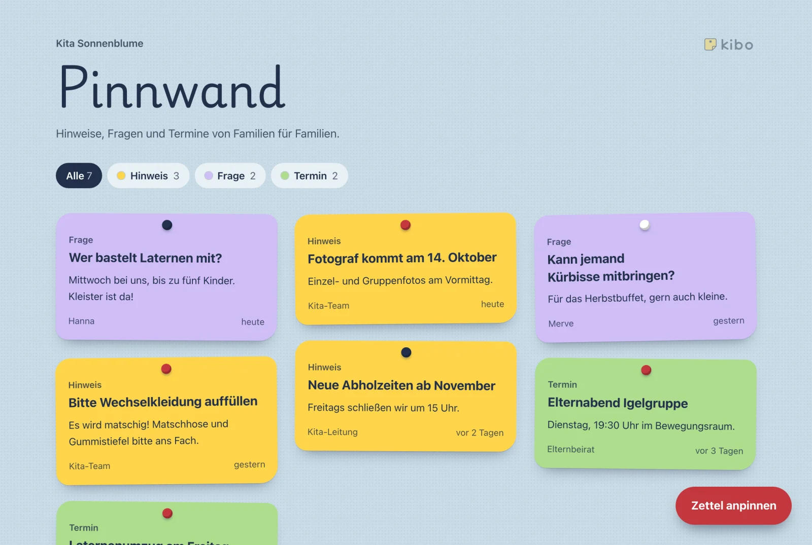
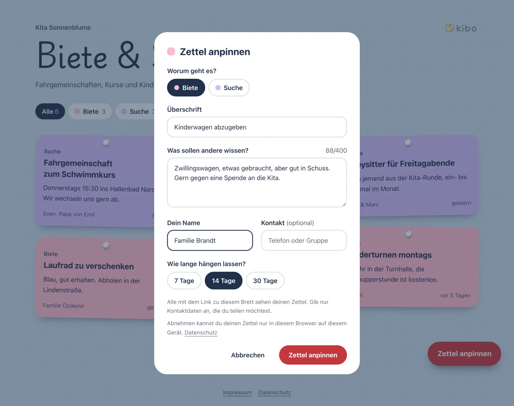

# Zettel

Zettel sind die Einträge auf einem Brett. Eltern pinnen sie selbst an; die Kita
behält den Überblick und kann jeden Zettel wieder abnehmen.

## Einen Zettel anpinnen

Wer den Kita-Link hat, öffnet das Brett und wählt „Zettel anpinnen“ – ein
Konto braucht es dafür nicht.

- **Worum geht es?** Die Kategorie, zum Beispiel „Gesucht“ oder „Gefunden“.
  Welche es gibt, hängt von der [Art des Bretts](./bretter.md#brett-arten) ab.
- **Überschrift** und **Text** – kurz und so, dass andere wissen, worum es
  geht.
- **Dein Name**, zum Beispiel „Mama von Ida“.
- **Kontakt** ist freiwillig: eine Telefonnummer oder der Name einer Gruppe.
  Alle mit dem Link sehen den Zettel, also nur angeben, was geteilt werden
  soll.
- **Wie lange hängen lassen?** 7, 14 oder 30 Tage.

Über dem Brett lassen sich die Zettel nach Kategorie filtern. Ein Antippen
öffnet den Zettel mit Text, Name und Kontakt.

## Laufzeit

Jeder Zettel verschwindet nach der gewählten Zeit von selbst: Er ist dann
sofort nicht mehr zu sehen und wird kurz darauf endgültig gelöscht. Verlängern
lässt sich ein Zettel nicht – wer ihn weiter braucht, pinnt ihn neu an.

## Einen Zettel abnehmen

- **Eltern** können ihren eigenen Zettel vorzeitig abnehmen, solange sie
  dasselbe Gerät und denselben Browser benutzen wie beim Anpinnen. Der Zettel
  zeigt dann „Das ist dein Zettel“ und den Knopf zum Abnehmen. Auf einem anderen
  Gerät oder nach dem Löschen der Browserdaten geht das nicht mehr; dann hilft
  die Kita. Auf dem iPhone zählen Safari und Kibo auf dem Home-Bildschirm
  dabei als zwei verschiedene Browser. Dafür merkt sich der Browser beim
  Anpinnen einen Schlüssel zum Zettel – nur auf dem Gerät, erst ab dem ersten
  eigenen Zettel – und vergisst ihn, sobald der Zettel abgelaufen ist.
- **Die Kita** kann jeden Zettel entfernen: auf der Seite des Bretts im
  Admin-Bereich, in der Liste „Zettel“. Dort stehen auch Name, Kontakt und das
  Ablaufdatum.

Ein abgenommener Zettel ist sofort weg und lässt sich nicht wiederherstellen.

Eltern können einen Zettel, der nicht auf das Brett gehört, auch der Kita
melden; das Team entscheidet dann unter „Meldungen“
([Meldungen](./meldungen.md)).

## Wenn ein Zettel nicht angenommen wird

Kibo begrenzt, wie viele Zettel in kurzer Zeit von einem Anschluss kommen, und
weist einen Zettel ab, dessen Text auf dem Brett schon hängt. Das schützt das
Brett, falls der Link einmal in falsche Hände gerät.

- **„Bitte versuch es in … nochmal“:** Es kamen gerade viele Zettel aus
  demselben Netz, etwa aus dem WLAN der Kita. Der Text bleibt im Formular
  stehen; nach der genannten Zeit klappt es wieder.
- **Der Zettel hängt schon:** Derselbe Text wird innerhalb von 24 Stunden kein
  zweites Mal angenommen. Ist der erste Zettel abgenommen, ist der Text sofort
  wieder frei.

Tauchen unerwünschte Zettel auf, entfernen Sie sie und
[erzeugen einen neuen Kita-Link](./bretter.md#einen-neuen-link-erzeugen). Die Regeln
im Einzelnen beschreibt der
[Spam-Schutz](../selbst-hosten/spam-schutz.md).
